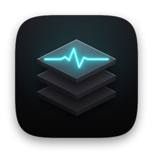
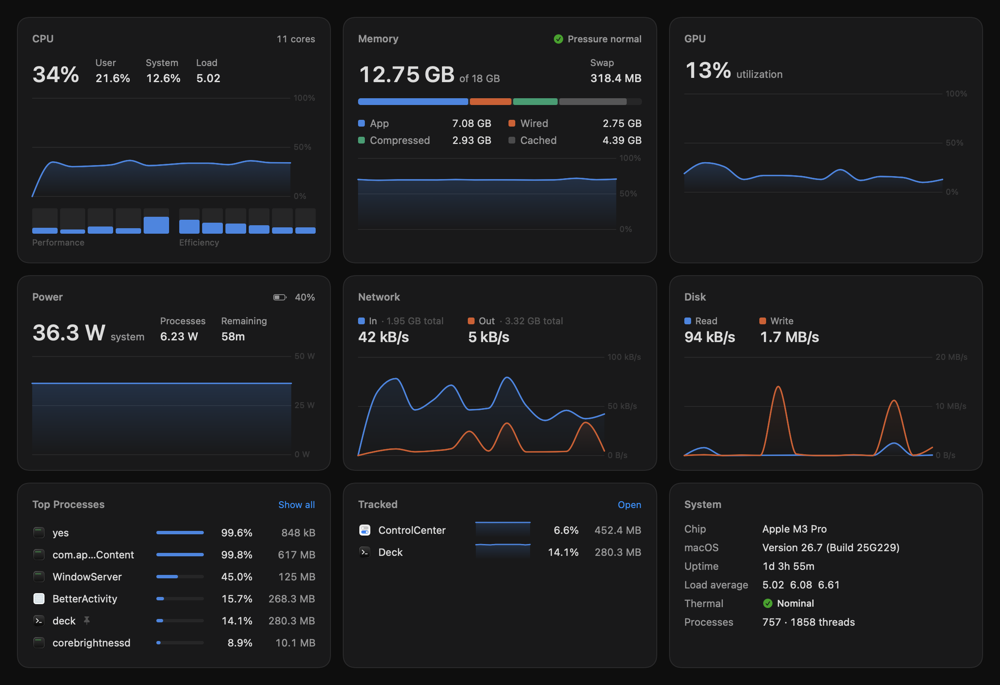
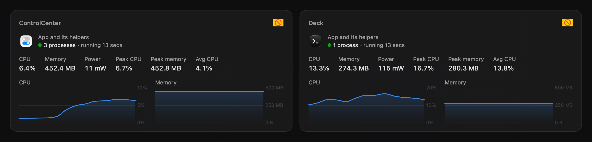
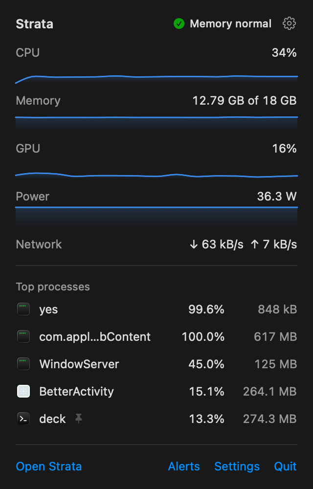
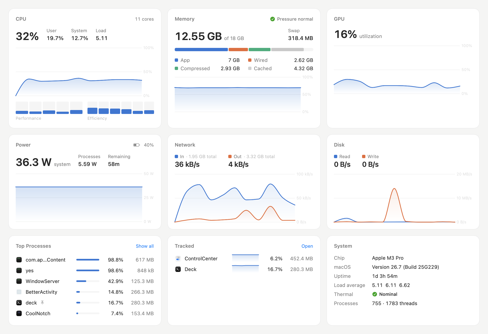

<p align="center">
  
</p>

<h1 align="center">Strata</h1>

<p align="center">A calmer Activity Monitor for macOS: processes, drivers, files and startup items, in layers.</p>

<p align="center">
  
</p>

## What it does

**Overview.** CPU (per core, performance and efficiency clusters), memory with pressure, GPU, power, network and disk, each with a chart you can hover over for 1, 5 or 15 minutes of history.

**Processes.** Every process with CPU, memory, real power in watts (from the kernel's per-process energy counters), threads, CPU time and disk I/O, as a list or a tree. Values update every second but rows hold their places for a few seconds, and never move while the pointer is on the list, so nothing jumps out from under you. The inspector shows live charts, arguments, environment, open files, network connections and a `sample` of the process.

**Tracked.** Follow an app (with all its helpers) or a process by name over time, even across restarts: current, peak and average CPU and memory, with history. Set your own limits and get told when it goes over them or stops running.

**Alerts.** Memory pressure, memory and swap use, sustained CPU, a runaway process, a process using too much memory, a nearly full disk, a hot Mac, a low battery. Each threshold is yours to set; alerts arrive as notifications, stay in a history, and repeat at most every so often while they last.

**Menu bar.** CPU and memory at a glance, with a panel of sparklines, the busiest processes and anything alerting. Choose what it shows, or turn it off, in Settings, where Strata can also open at login.

**Drivers.** Loaded kernel extensions, system extensions (DriverKit, network, endpoint security, camera), USB devices, and a searchable I/O Registry explorer.

**Files.** Volumes with capacity and "who's using this disk", and a disk usage map you can drill into.

**Startup.** Launch agents and daemons with their state, signer, and enable/disable or load/unload; background items from macOS's login items database.

<p align="center">
  
</p>

<p align="center">
  
  &nbsp;&nbsp;
  
</p>

## Build

Needs macOS 26 on Apple silicon, Xcode 26 or later, and [XcodeGen](https://github.com/yonaskolb/XcodeGen) (`brew install xcodegen`).

```sh
make install    # Release build into /Applications, then open it
make run        # build (Debug) and open the app
make release    # Release build
make selftest   # build, then sample everything once headlessly and check the alert and ordering logic
make clean
```

The app lands in `.build/xcode/Build/Products/<Configuration>/Strata.app`. The Xcode project is generated from `project.yml`; `make` regenerates it.

`Strata --snapshot <dir> [page …]` renders pages to PNGs in light and dark without needing Screen Recording permission. `swift tools/make-icon.swift Strata/Assets.xcassets/AppIcon.appiconset` redraws the icon.

## Permissions

Strata is not sandboxed; it reads system state the way `ps`, `top` and `ioreg` do.

- Processes owned by root or other users show CPU and memory (from the setuid `ps`); their open files and connections need an administrator password, asked for when you want them.
- Quitting another user's process, changing system launch daemons, and reading background items ask for an administrator password.
- Disk Usage reads more folders with Full Disk Access.
- Alerts ask for permission to send notifications the first time one fires.

## Layout

```
Strata/
  App/       entry point, window, menu bar, settings, self-test, snapshots
  Core/      samplers and readers: libproc, Mach host stats, IOKit, launchd, disk scanning
  Stores/    the live monitor, stable ordering, tracking, alerts
  Views/     Overview, Processes, Tracked, Alerts, Drivers, Files, Startup, shared components
tools/       icon generator
```

## License

MIT. See [LICENSE](LICENSE).
